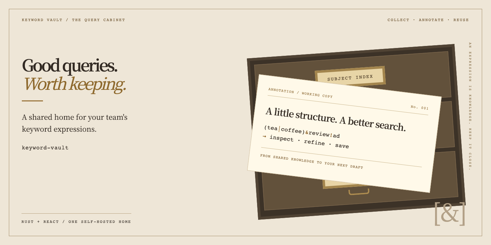

# Keyword Vault

<p align="center">
  <a href="https://github.com/NatLee/keyword-vault/actions/workflows/ci.yml"></a>
  
  
  
  
</p>

做輿情分析、社群聆聽的團隊，每個人手上都有一堆搜尋用的關鍵字語法：`(珍珠奶茶|(珍珠 鮮奶 ~))&手搖!廣告` 這種。它們通常散在各自的試算表和聊天紀錄裡，同一個主題每個人各寫一份，改了也沒人知道。

Keyword Vault 是放這些語法的地方：寫的時候馬上檢查語法、看得到實際送給 Elasticsearch / OpenSearch 的 `query_string`；寫好可以分享給群組或所有人；常用的幾組可以用編號組成新的關鍵字，底下的改了，上面的跟著更新。

一份 Docker Compose 啟動 nginx 前端與內部 Rust API，資料存於 SQLite，不需要另外架搜尋引擎。

主題索引、記錄架、語法拆解與私人版本儲存分成不同工作區。
節點選取會連動路徑與右側詳情，過渡為 160–180ms；減少動態偏好直接顯示結果。
[觀看實際節點操作錄影（WebM）](docs/images/feature-motion.webm) · [樣式與無障礙驗證](docs/themed-motion-verification.md)。

## 從主題分冊，到一份新的私人草稿

以下三張圖來自內建的虛構 demo，在隔離執行個體操作同一筆 **#1「珍珠奶茶」**。
封面是獨立的品牌插畫；流程圖則是實際頁面擷取。

**1. 依主題找語法。** 開啟「語法庫」，點左側「手搖飲」主題分冊。
畫面收斂為這個主題的三筆可讀語法；找到 #1「珍珠奶茶」，按「拆解與試寫」。

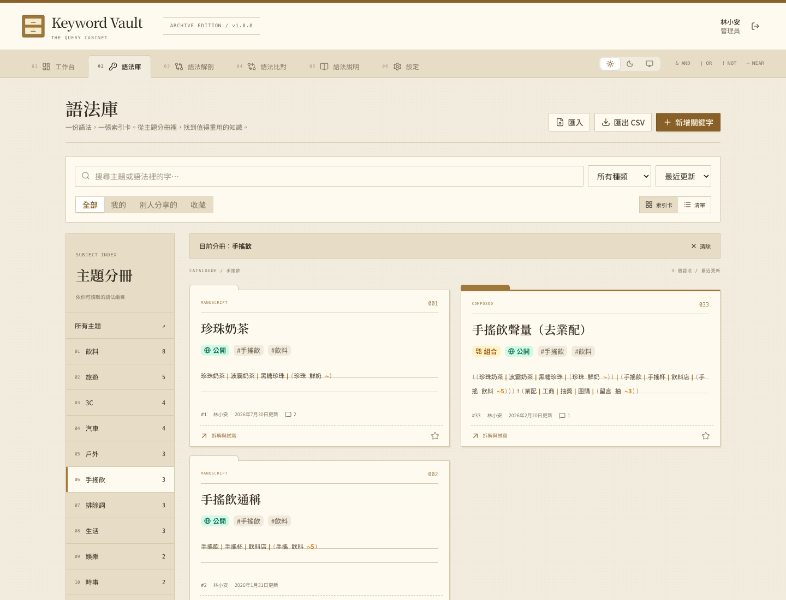

**2. 在推敲桌試寫。** 載入的原稿是 `珍珠奶茶|波霸奶茶|黑糖珍珠|(珍珠 鮮奶 ~)`。
將草稿改為 `(珍珠奶茶|波霸奶茶)&評價!(業配|廣告)`，再選取「廣告」節點。
右側標明它位於排除群組內，上方同步顯示 Rust API 實際產生的 `query_string`。
圖中捲到推敲工作區，頂部仍可看到「從 #1 載入」。

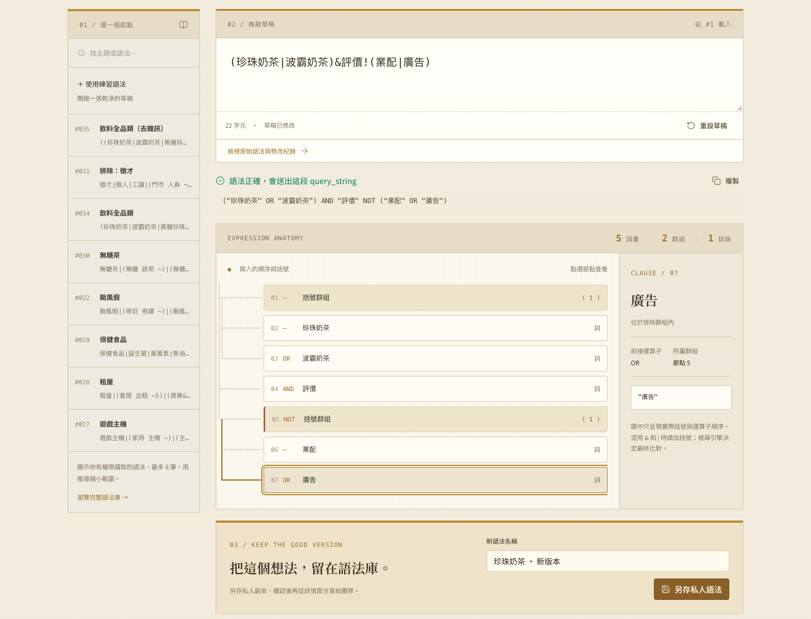

**3. 把新版本留下。** 名稱填入「珍珠奶茶 · 去除廣告的口碑草稿」，按「另存私人語法」。
頁面底部出現「私人語法已儲存」及「開啟新語法」連結；新語法保留主題標籤、範圍為私人，
#1 原稿不變。下圖捲到儲存結果；捕圖腳本會核對 API 中的副本，隨後刪除這筆臨時資料。

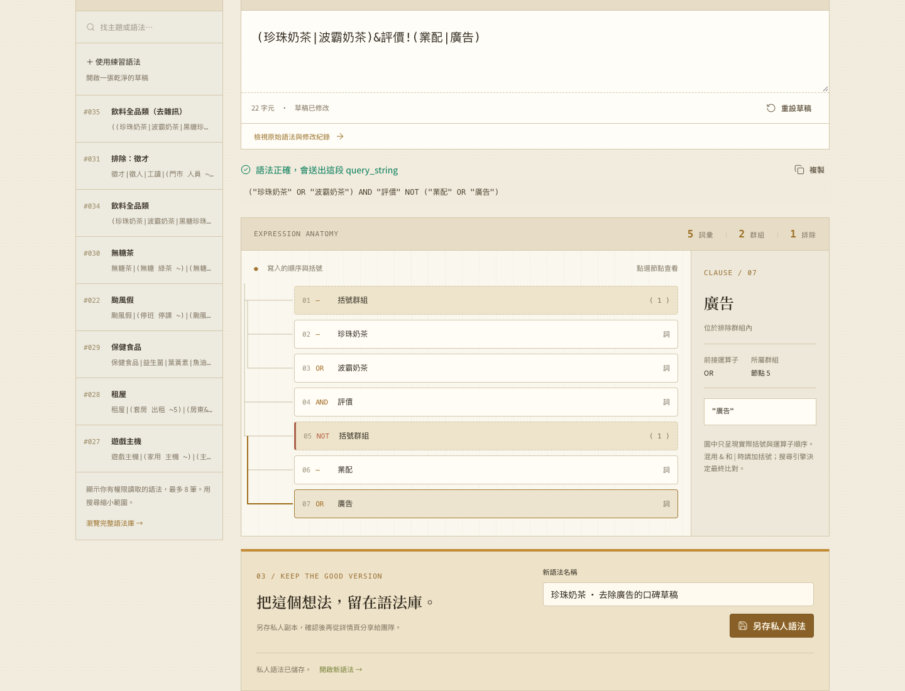

[重現步驟與驗證結果](docs/workflow-verification.md) · [可編輯的封面來源](docs/images/src/cover.html)

## 工作區設計

以「關鍵字典藏室」為主題：黃銅標籤抽屜、主題分冊、帶編號的索引卡與修訂登錄簿。首頁四個抽屜分別開啟全部館藏、我的手稿、組合索引與書籤收藏，數量由你有權限讀取的 API 資料計算。

語法庫可在索引卡與精簡清單間切換；左側列出全部主題標籤，篩選仍保留在網址。每張卡都保留分享範圍、組合狀態與作者，並可直接「拆解與試寫」。手機把主題分冊收成可橫向捲動的索引。

暖赭色、象牙紙面與墨色組成完整的深淺模式。Noto Sans TC 與 Noto Serif TC 皆由套件自架，字型不需要外部 CDN。

## 語法推敲桌

從導覽列開啟「語法解剖」，或在任何語法詳情按「拆解與試寫」。左側可搜尋自己有權限讀取的語法，載入後在草稿裡調整，再逐一選取群組、詞彙或排除節點。

圖與編譯結果都來自 Rust API：前端不另寫解析器，也不推測 AND／OR 優先順序。等待新結果或語法有錯時，舊圖會清除。草稿可另存為私人語法；組合語法會以當時的展開內容另存一般語法。原始查詢不會因試寫而變更。

- 點選節點，查看所屬群組、直接排除、群組內排除與片語 slop。
- 詳情頁也有同一份結構圖；既有編輯器可展開結構預覽後儲存修改。
- 大型語法預覽前 80 個節點（編輯器 24 個）；完整語法與編譯結果仍可閱讀與複製。

<details><summary>語法解剖圖庫：淺色、深色與手機</summary>

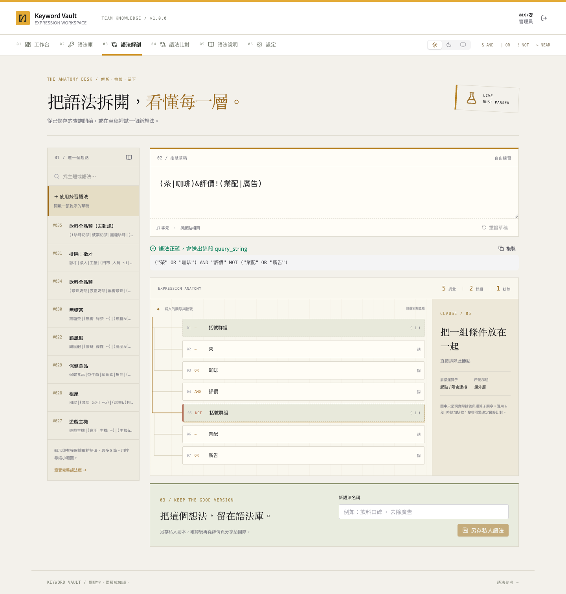

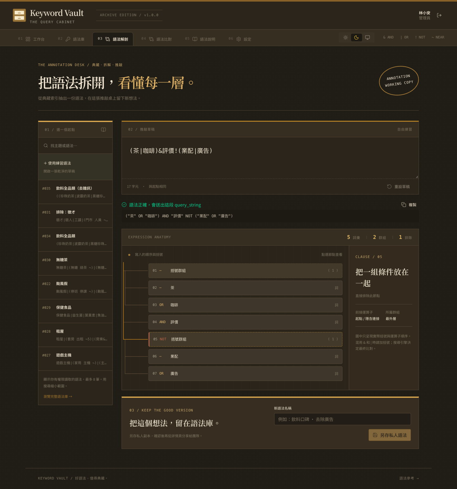
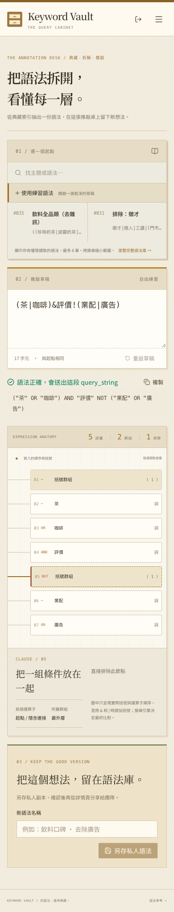

</details>

## 功能

- **語法即時檢查**：邊打邊檢查，錯在第幾個字元直接告訴你；正確時顯示轉出來的 `query_string`，可以一鍵複製。
- **分享範圍**：私人、群組、公開三種。別人的關鍵字可以看、可以收藏、可以留言，但只有擁有者能改。
- **組合關鍵字**：用 `(#3|#5)!#8` 把現有的關鍵字接起來。每個關鍵字展開時自己包一層括號，意思不會跑掉；被引用的關鍵字改了語法，組合關鍵字會跟著更新。
- **修改紀錄**：每次改語法都留下紀錄，點開就看到改了哪幾個字。
- **語法比對**：兩段很長的語法貼進去，哪裡不一樣一眼看出來。
- **標籤、收藏、留言、搜尋**，以及 CSV 匯入和匯出。匯入時每一列都先檢查語法，有一列不對就整批不匯入，並列出每一列的問題。
- **帳號和群組**：第一個打開網頁的人建立管理員，沒有預設帳號，也沒有預設密碼。密碼用 Argon2 雜湊，登入是 HttpOnly cookie。
- 淺色和深色模式。

## 畫面

<details><summary>展開其他功能與深淺模式圖庫</summary>

### 語法庫

<p align="center">
  <picture>
    <source media="(prefers-color-scheme: dark)" srcset="docs/images/screenshot-keywords-dark.png">
    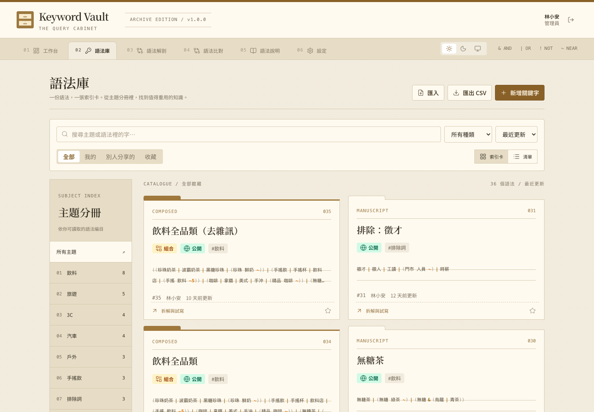
  </picture>
</p>

### 語法工作台

<p align="center">
  <picture>
    <source media="(prefers-color-scheme: dark)" srcset="docs/images/screenshot-overview-dark.png">
    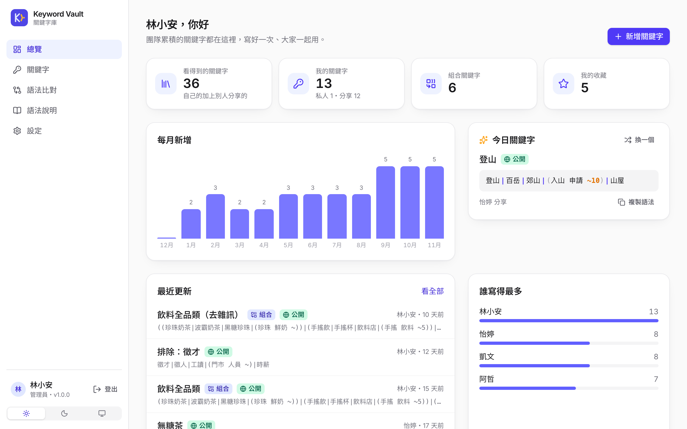
  </picture>
</p>

### 新增關鍵字

語法寫到一半就知道對不對，下面是實際會送出去的 `query_string`。

<p align="center">
  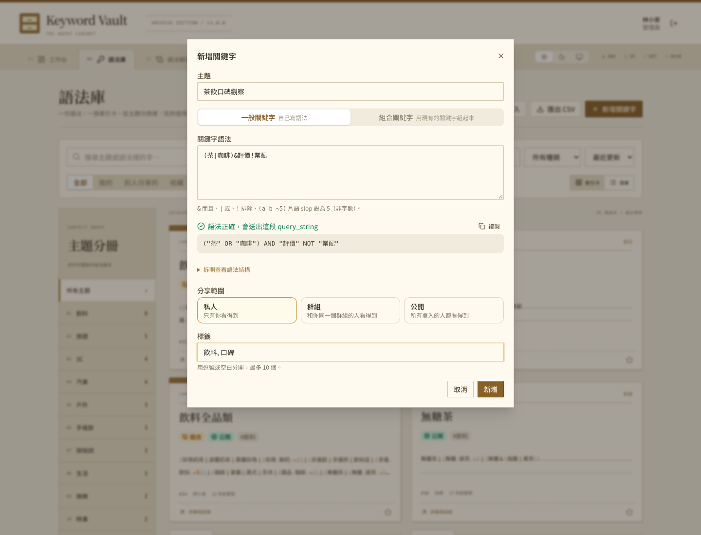
</p>

### 組合關鍵字

`(#1|#2)!#3`：手搖飲的幾種說法，扣掉業配和抽獎文。

<p align="center">
  <picture>
    <source media="(prefers-color-scheme: dark)" srcset="docs/images/screenshot-detail-dark.png">
    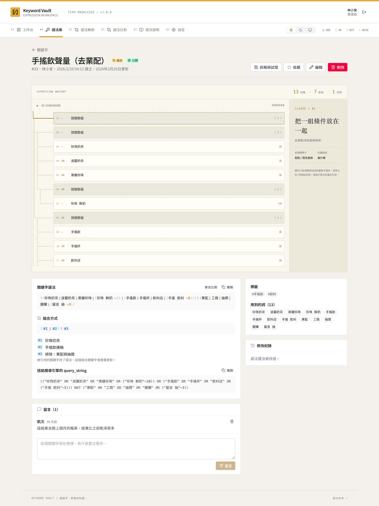
  </picture>
</p>

### 修改紀錄和留言

<p align="center">
  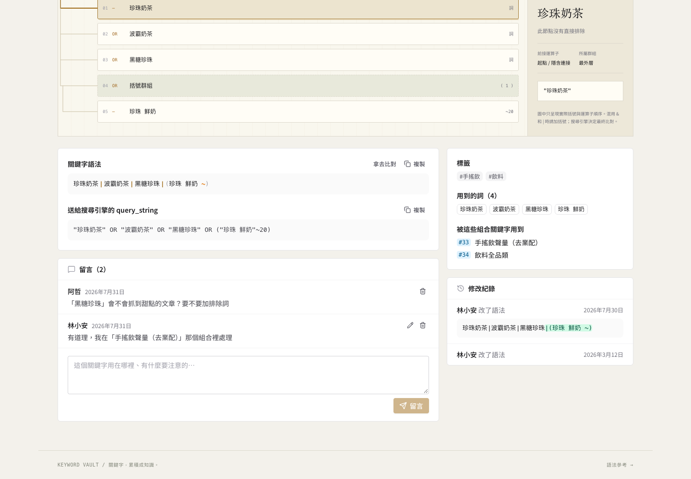
</p>

### 語法比對

<p align="center">
  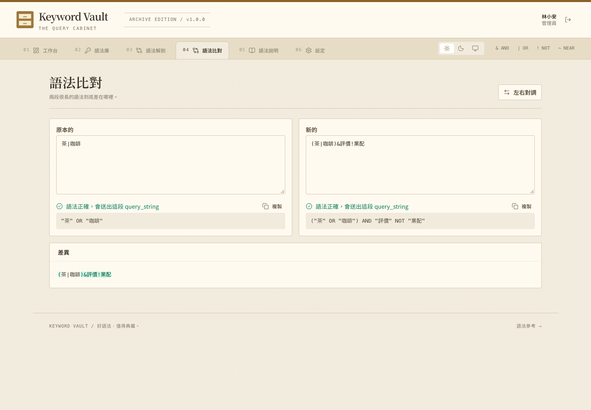
</p>

### 語法說明

說明頁上面有練習區，表格裡的每個例子都可以按一下直接試。

<p align="center">
  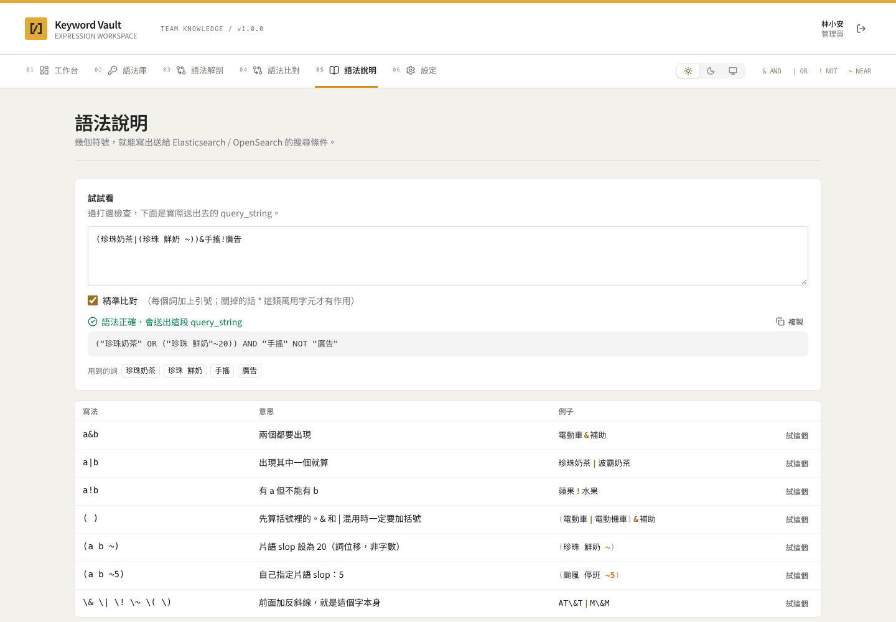
</p>

### 設定

<p align="center">
  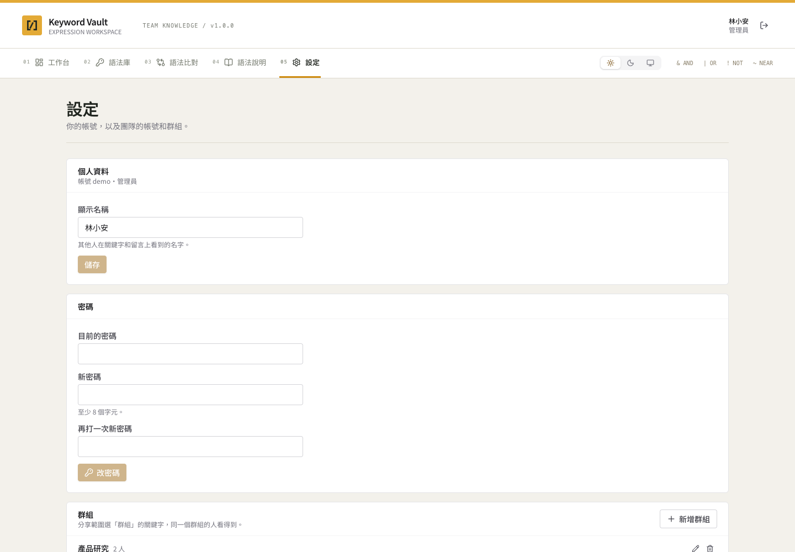
</p>

</details>

## 快速開始

```bash
git clone https://github.com/NatLee/keyword-vault.git && cd keyword-vault
docker compose up -d --build
```

只有 nginx 發布 `8686`；前端資產由 nginx 提供，API、OAuth 與 MCP 轉送至內部 `keyword-vault`。資料仍保存於原本的 SQLite volume。

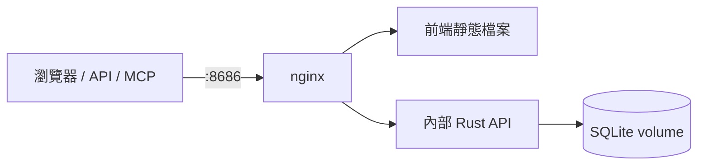

瀏覽器網址須與 `ACCESS_PUBLIC_URL` 完全相同；預設使用 `http://127.0.0.1:8686`。正式 HTTPS 網域、既有 URL 變數、代理路由與升級方式見 [nginx 部署說明](docs/nginx-deployment.md)。

1. 打開 <http://127.0.0.1:8686>。
2. 第一次會請你建立管理員帳號（密碼至少 8 個字元）。
3. 到「設定」新增其他人的帳號，需要的話建立群組。
4. 到「語法庫」按「新增關鍵字」，或用「匯入」一次放進一批。

想先看有資料的樣子，可以在**空的資料庫**裡放範例資料（4 個帳號、39 個關鍵字，內容都是虛構的）：

```bash
docker compose run --rm keyword-vault keyword-vault demo
```

密碼會印在畫面上；管理員帳號是 `demo`。

忘記密碼時，管理員可以在「設定」幫別人重設。連管理員都進不去的話：

```bash
docker compose exec keyword-vault keyword-vault reset-password <帳號>
```

## 語法

| 寫法 | 意思 | 轉出來的 `query_string` |
|---|---|---|
| `a&b` | 兩個都要出現 | `"a" AND "b"` |
| `a\|b` | 出現其中一個 | `"a" OR "b"` |
| `a!b` | 有 a 但不能有 b | `"a" NOT "b"` |
| `(a\|b)&c` | 先算括號裡的 | `("a" OR "b") AND "c"` |
| `(a b ~)` | 片語 slop 為 20（詞位移，非字數） | `("a b"~20)` |
| `(a b ~5)` | 自訂片語 slop 為 5 | `("a b"~5)` |
| `\&` `\|` `\!` `\~` `\(` `\)` | 這個字本身 | |

全形的 `＆｜！（）` 會自動當成半形。運算子照寫的順序送出去，不會自動排優先順序，`&` 和 `|` 混用時請加括號。

語法解析器是另一個獨立的 Rust crate，[es-keyword-query](src/api/vendor/es-keyword-query)，原始碼一起放在這個 repo 裡。

## CSV 匯入

第一列是欄位名稱，`主題` 和 `關鍵字` 一定要有：

```csv
主題,關鍵字,分享範圍,標籤
手搖飲,珍珠奶茶|(珍珠 鮮奶 ~),公開,飲料;熱門
電動車,(電動車|電動機車)&補助!二手,私人,交通
```

`分享範圍` 是 `私人`、`群組` 或 `公開`，沒寫是私人；`標籤` 用 `;` 分開。匯出的檔案可以直接再匯入。

## 設定

都是環境變數，全部可以不設。用 docker compose 時寫在同一個資料夾的 `.env`。

| 變數 | 預設 | 說明 |
|---|---|---|
| `KV_PORT` | `8686` | docker compose 對外的 port |
| `KV_PUBLIC_URL` | | 外部看到的網址，例如 `https://keywords.example.com`。是 https 時登入 cookie 會加 `Secure`，也用來判斷寫入請求是不是同源 |
| `KV_COOKIE_SECURE` | 看 `KV_PUBLIC_URL` | `true` / `false`，強制指定 cookie 要不要加 `Secure` |
| `KV_DEFAULT_SLOP` | `20` | `~` 後面沒寫數字時用的距離 |
| `KV_BIND` | `0.0.0.0:8686` | 伺服器聽的位址 |
| `KV_DATA_DIR` | `data`（映像檔裡是 `/app/data`） | 放 SQLite 資料庫的資料夾 |
| `KV_DATABASE_PATH` | `<KV_DATA_DIR>/keyword-vault.db` | 資料庫檔案 |
| `KV_STATIC_DIR` | `src/web/dist`（映像檔裡是 `/app/web`） | 前端檔案的位置 |

資料在 `keyword-vault-data` volume。建議先停止服務再複製整個資料目錄；
若要在線上備份，使用 SQLite backup API，避免漏掉 WAL 中尚未合併的資料。

## 開發

需要 Rust（stable）、Node 24、pnpm。

```bash
# 後端：http://127.0.0.1:8686
cd src/api && cargo run

# 前端：http://localhost:5173，/api 會轉給後端
cd src/web && pnpm install && pnpm dev
```

```bash
cd src/api && cargo fmt --check && cargo clippy --all-targets -- -D warnings && cargo test
cd src/web && pnpm test && pnpm build
bash docs/smoke-test.sh http://127.0.0.1:8686   # 對一個空的執行個體跑一輪
```

API 文件在 [docs/api.md](docs/api.md)。

## 驗證與畫面重現

[典藏室設計與驗證](docs/query-cabinet.md) 記錄此版的分類導覽、字型來源與畫面驗證。

所有操作截圖都來自內建的虛構 demo 資料；README 封面是獨立 HTML 插畫。可在隔離的 demo 執行個體上執行：

```bash
python -m pip install playwright
python -m playwright install chromium
KV_QA_URL=http://localhost:5173 KV_QA_PASSWORD='<demo password>' python docs/capture-ui.py
KV_QA_URL=http://localhost:5173 KV_QA_PASSWORD='<demo password>' python docs/capture-insights.py
KV_QA_URL=http://localhost:5173 KV_QA_PASSWORD='<demo password>' python docs/capture-workflow.py
```

腳本會驗證登入、搜尋、收藏、新增、語法錯誤、手機導覽及登出，並更新畫面。
三個腳本會新增測試語法後刪除，請只對 demo 資料庫執行。
[語法解剖設計與驗證](docs/visual-insights.md) 包含結構 API 與新版互動流程。
[設計與稽核記錄](docs/design-and-audit.md) 包含測試結果與限制。

<details><summary>手機語法庫</summary>

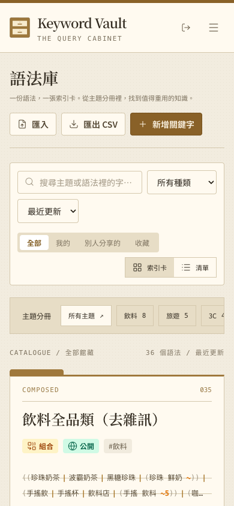

</details>

## Account connections, API and MCP

Use the existing password setup/login and visit **連線與存取**. Existing account IDs, owner/public/group visibility and expression limits remain authoritative for API and MCP. A private record does not become visible simply because the caller is an administrator. Group removal and account disable take effect on the next invocation.

The canonical default is `http://127.0.0.1:8686`. Set `ACCESS_PUBLIC_URL` to the exact browser origin, including its port. For Vite development use `ACCESS_PUBLIC_URL=http://localhost:5173` on the backend; Vite proxies `/api`, `/oauth`, `/.well-known` and `/mcp` without rewriting the browser Host.

`ACCESS_PUBLIC_URL` is the canonical origin used for issuer, resource, callback and same-origin checks. Use HTTPS in deployment; HTTPS forces Secure cookies. Configure GitHub with `ACCESS_GITHUB_CLIENT_ID` / `ACCESS_GITHUB_CLIENT_SECRET`, and Google with `ACCESS_GOOGLE_CLIENT_ID` / `ACCESS_GOOGLE_CLIENT_SECRET`. Register these exact callback URLs with the providers:

- `{origin}/oauth/callback/github`
- `{origin}/oauth/callback/google`

Sign into an existing local account first and link its provider identity in Connections. Provider login requires an existing binding; there is no automatic signup or email-based account merge. Missing provider configuration produces disabled native buttons with an explanation. Disconnecting cannot remove the final login method.

Connections creates a personal key with explicit scope (`keywords:read / expressions:read`), audience (`{origin}/api/v1` and/or `{origin}/mcp`) and expiry. Copy its raw value once; closing the panel removes it from the UI, and it is never stored in browser storage. Revoke keys and OAuth grants from the same page. Only cookie sessions can manage connections, clients and consent.

Domain operations are `search_keywords`, `get_keyword`, `inspect_expression`, `compare_expressions`. API calls use `POST /api/v1/{operation}`, JSON arguments and `Authorization: Bearer <key-or-access-token>`; `/api/v1/openapi.json` describes the fixed schemas. No caller-supplied destination URL or identity header is supported. MCP uses Streamable HTTP at `/mcp`, negotiated version **2026-07-28**, discovery and normal SDK tool calls (no custom initialize payload). OAuth clients discover metadata, use authorization code + PKCE S256, exact resource/audience and the native immutable consent form; administrators register approved client redirect URIs in Connections. Public dynamic registration is disabled by default; set `ACCESS_DYNAMIC_CLIENT_REGISTRATION=true` only when needed. Admin registration remains available.

Usage shows real UTC daily counts for 7/30/90 days, outcomes, transports and pending attempts. A real domain operation records one attempt across API/MCP; discovery, management and rejected credentials do not inflate usage. Detailed audit retention is 90 days. Event payloads omit raw keys, tokens and domain arguments/results. Legacy HTTP spans record method and matched route patterns; access routes and internal dispatch avoid payload tracing.

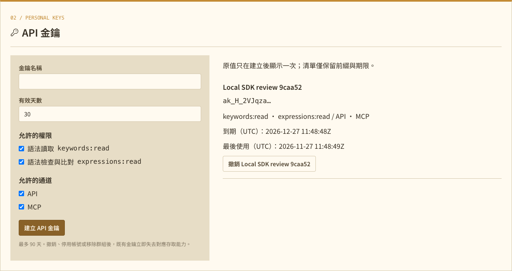
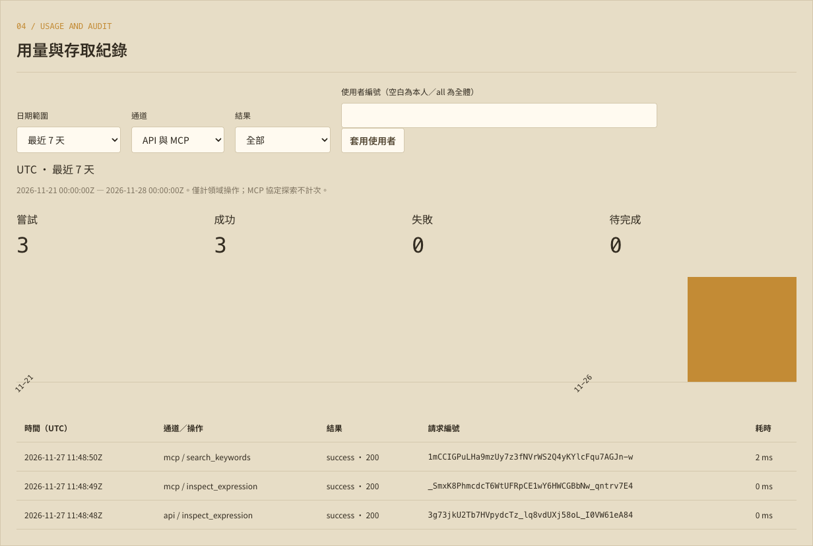
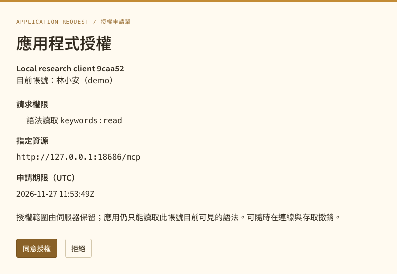

These are real local workflows with synthetic domain data and the feature-gated loopback provider, including signed Google OIDC verification. They do not claim live provider registration. [Access verification and reproduction](docs/access-verification.md) records tests, screenshot provenance and remaining deployment checks.

## 授權

[MIT](LICENSE) © Nat Lee


## 首次登入與建立管理員

第一次開啟空白安裝時，首頁、登入頁和需要登入的頁面都會自動導向 `/first-login`。輸入 3–32 個英文字母、數字或 `. _ -` 的帳號、選填顯示名稱，以及 8–200 個字元的密碼與確認密碼，按「建立管理員」後即以新管理員身份進入工作空間。密碼不一致時不會送出請求。

這個頁面只用來建立第一位管理員。有帳號的安裝會改顯示 `/login`；其他成員可由管理員新增，或依註冊設定自行申請。若另一位管理員已先完成設定，舊頁面會自動轉成登入。透過 OAuth 登入的合法本站授權流程會在建立帳號後接續進行。

Docker 對外網址請維持 `KV_PUBLIC_URL` 與 `ACCESS_PUBLIC_URL` 同源。操作與實際瀏覽器驗證見 [首次登入驗證紀錄](docs/first-login-verification.md)。

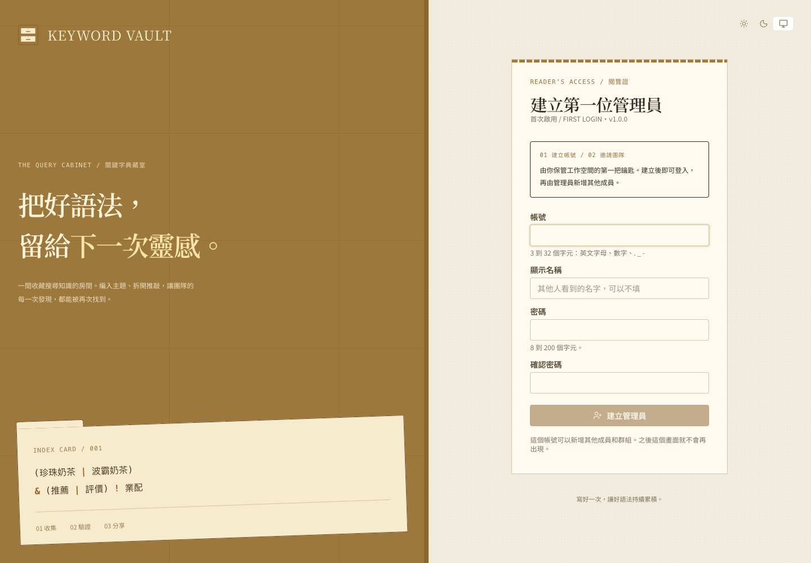

## 成員註冊與審核

`/first-login` 只用來建立第一位管理員。後續成員可從登入頁的「註冊帳號」進入 `/register`；新安裝預設關閉註冊。管理員可在「設定 → 註冊與審核」選擇關閉、審核後開通，或開放立即註冊。關閉只停止新申請，仍可處理已送出的申請。

密碼註冊包含確認密碼；帳號為 3–64 個英數字或 `. _ -`，密碼為 12–256 個字元，顯示名稱選填、最多 100 個字元。設定 Google／GitHub 後，註冊頁只顯示可用的供應商。第三方註冊會建立一般成員，不會依電子郵件合併既有帳號；原有第三方「登入」入口仍只登入已綁定的帳號。

待審核或已拒絕的帳號無法進入工作區，也無法使用 API／MCP。管理員可依狀態分頁查看申請、核准或填寫原因後拒絕；下方處理紀錄保留申請、審核及註冊設定變更的時間與操作者。既有帳號的停用／啟用不會取代註冊審核。

[註冊與審核驗證紀錄](docs/registration-verification.md) 提供測試範圍與實際瀏覽器截圖。

實際 Chrome 畫面：[註冊頁・桌面淺色](docs/images/registration-register-desktop-light.png) · [管理員審核・手機深色](docs/images/registration-review-mobile-dark.png)。完整桌面／手機、淺色／深色共八張截圖見驗證紀錄。 可在建置後執行 `python docs/verify-registration.py --binary /path/to/binary` 重現完整流程；需安裝 Python Playwright 與 Google Chrome。
