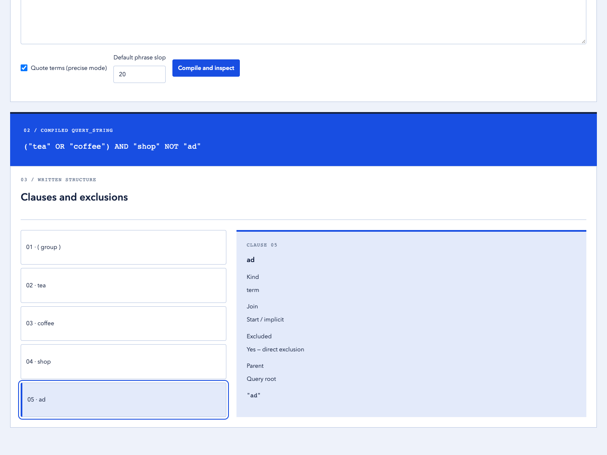
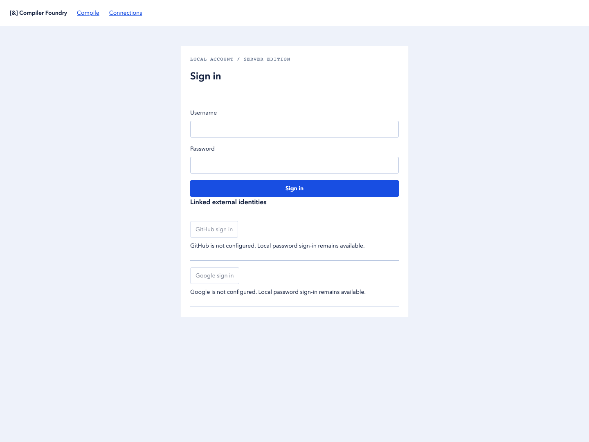

# Access integration verification

The host uses the identical frozen access-kit source SHA `950710417855acd38c245c50c1facb6e456b45df9c6be2c6fb804f1f7a47082a`, authoring commit `5f35e0a188996f66fefe1084666629af0ffb8578`, schema SHA `5a6dfc0ee83c70fce2cb884cbd1541f5ab8e49487cea76ae009a86f10fc26157`. `python crates/access-kit/scripts/snapshot.py --check` verifies the vendored bytes; host migrations0002+0003 concatenate to the identical schema2 SQL.

## Automated evidence

- Rust host tests and `cargo clippy --all-targets --locked -- -D warnings` pass against this snapshot. ES optional host:6 unit +3 access +1 stdin-bootstrap tests. Vault:12 unit +11 original domain integration +3 access tests. The host access tests run the actual rmcp3.12 client with protocol2026-07-28, API happy paths, revoked/disabled authority, audiences/scopes, and exact durable count-once assertions.
- Vault additionally proves current owner/public/group rules, immediate membership removal, private denial for unrelated administrators and forged-header denial. Its frontend20 tests pass, including once-only secret/focus return, provider-disabled state, request shape and immutable native consent forms; production build passes.
- Browser capture performs real password login, GitHub/Google linking through the loopback test provider, personal key create→API+official SDK→usage, admin client registration, PKCE/native consent approval→SDK, separate denial, grant/key revocation→denial. It asserts exactly3 recorded domain attempts and no bearer/canary payload in logs/events. Screenshots hide the raw key before capture.
- Actual browser computed-style checks cover1440/390px, light/dark, weights400/600 and padding/margin/gap multiples4. No page overflow or page errors. ES also checks long unbroken terms, keyboard clause selection and immediate final state under reduced motion. Real missing-provider instances prove disabled GitHub/Google login buttons. Source scans and PNG decode checks are part of the final review packet.

## Reproduce only in an isolated loopback demo

Build the host and SDK probe with `cargo build --manifest-path server/Cargo.toml --locked --features access-kit/test-support --example access_probe` and build the host binary with the same feature. Run the shared mock with:

```sh
cargo run --manifest-path crates/access-kit/Cargo.toml --features test-support --example mock_provider -- 127.0.0.1:19090
```

Set `ACCESS_TEST_MOCK_PROVIDER_URL=http://127.0.0.1:19090`, a dedicated data directory, and exact `ACCESS_PUBLIC_URL` on the demo host. This mock override is compiled out without test-support. Create a local demo account through the native setup, put its password in a private file, and run:

```sh
ACCESS_CAPTURE_PASSWORD_FILE=/private/demo/password ACCESS_CAPTURE_URL=http://127.0.0.1:18670 python docs/capture-access.py
```

The capture script requires Python Playwright with Chrome, refuses nonloopback URLs, writes three actual workflow PNGs, and mutates only the dedicated demo by binding providers/registering a client/creating then revoking credentials. Never run against production. The SDK probe accepts its bearer only through child-process environment and emits no secret.

## Deployment review

Live GitHub/Google application registration and production HTTPS callback delivery require deployment credentials and remain a manual deployment check. Recheck proxy canonical origin, cookie flags, provider redirect registration, retention/backup policy and browser screen-reader behavior in the intended deployment. Local mock results do not substitute for those checks.

Root reviewer independently passed Docker image builds and runtime smoke: native setup/login (ES stdin bootstrap), disabled-provider metadata, bearer API plus official Python MCP2.3 client negotiating Rust2026, exactly2 attempts/2 successes, revoke401 and persisted sessions/counts after restart. Evidence: `/tmp/tools-access-docker-smoke.log` and `/tmp/{es,vault}-access-docker-build.log`. Rebuild after any subsequent runtime changes. Reproduction uses `docker build -f server/Dockerfile -t es-keyword-query-server:access .`. Run with `-p 8670:8670 -e ACCESS_PUBLIC_URL=http://127.0.0.1:8670 -v <volume>:/app/data`; bootstrap the running container with `docker exec -i <container> es-keyword-query-server bootstrap demo` and password stdin. The image runs as uid10001; mount ownership must permit its SQLite writes.





## Ledger response-race regression

`python docs/verify-access-ledger.py` runs focused browser regressions against an isolated local admin demo. Configure `ACCESS_LEDGER_URL` and `ACCESS_LEDGER_PASSWORD_FILE` when using a different instance. It intercepts only audit GET responses, leaving the real frontend and password session in place. Requests are deliberately delayed to verify that owner A/API cannot overwrite owner B/MCP, old pagination cannot append or overwrite a new cursor, unapplied draft inputs do not alter pagination, rapid duplicate clicks issue one request, and overlapping page items render once. Both apps pass all four cases. Before the fixes, ES failed delayed reload ordering; Vault failed stale pagination and issued two duplicate pagination requests. No visual layout changed, so the access screenshot gallery remains current.

公開 OAuth 用戶端註冊預設關閉；需要動態註冊時，部署設定 `ACCESS_DYNAMIC_CLIENT_REGISTRATION=true`。管理員預先註冊不受公開名額影響。公開註冊須在24小時內取得使用者授權；未授權且無進行中流程者會回收，待授權名額最多256筆。新核心以附加migration0003升級schema2，保留既有0002的位元組與帳號資料。共用核心已通過獨立複查、27個Rust測試和5個snapshot測試；限流、併發稽核及MCP回應失敗計次的修正另有回歸測試。

## Final reviewed container acceptance

On 2026-11-27, rebuilt the reviewed schema2 snapshot and upgraded the previous schema1 container using the same SQLite volume. Existing accounts, sessions and two historical successful calls survived the additive migration. The final image passed discovery with public registration disabled, rejected public registration with `registration_disabled`, one authenticated REST operation plus one official Python MCP2.3 SDK operation, exactly two additional successes, revoked-key401 and restart persistence. Host tests, all-target clippy, rustfmt and snapshot validation also pass at this revision. Independent host review accepted the domain adapters and ledger ordering fixes; shared-core review accepted all recorded fixes. Local evidence: `/tmp/tools-access-upgrade-smoke.log` and `/tmp/es-keyword-query-reviewed-host-tests.log`.
