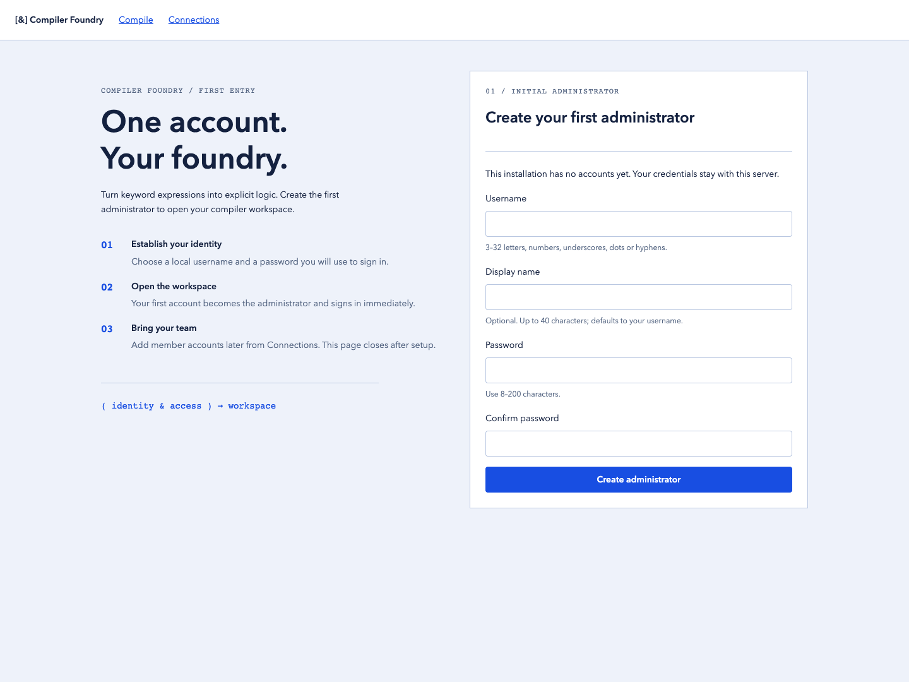
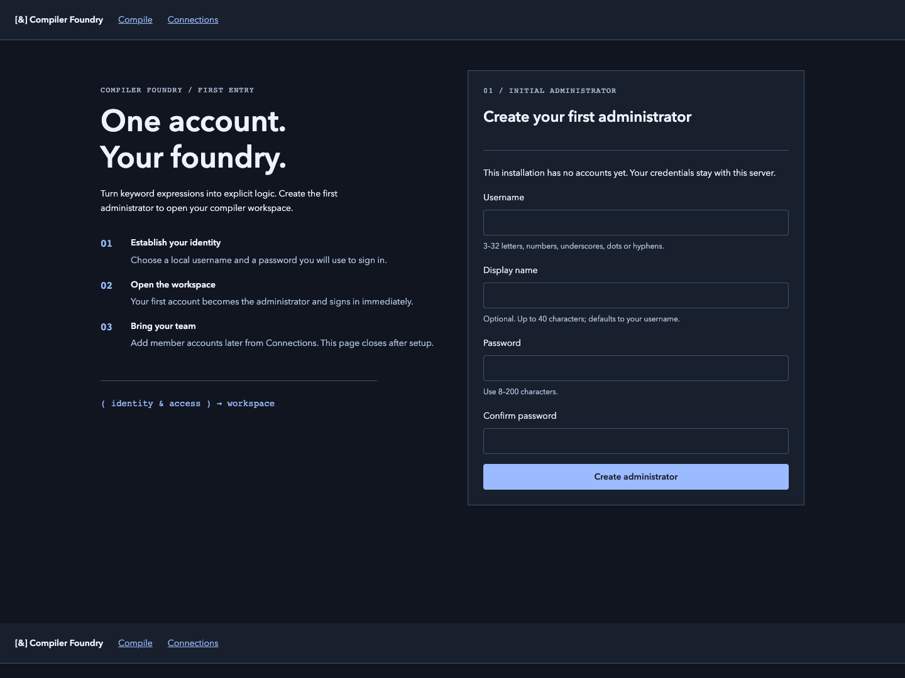
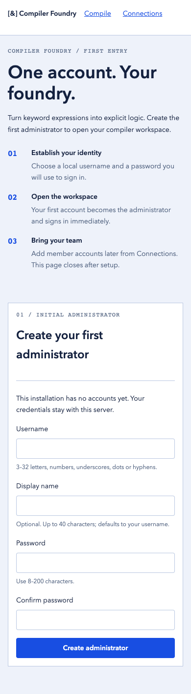
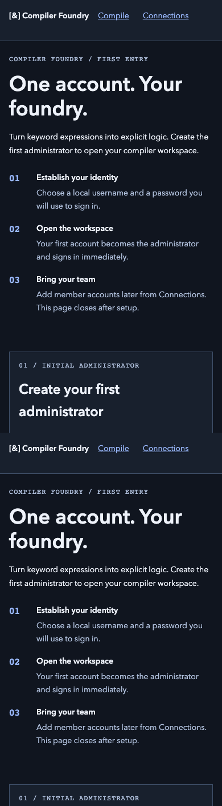
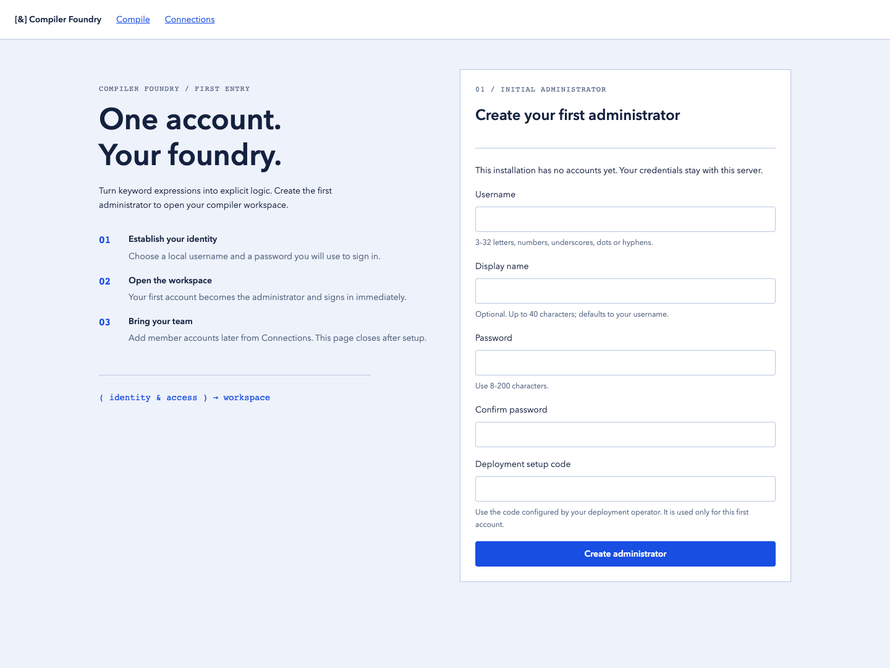

# First-login verification — 2026-11-27

The optional standalone server now has a dedicated `/first-login` page. An empty database sends root, login and protected entries there. The first account is an administrator and receives the existing session cookie; later accounts remain administrator-managed members. Existing installations close setup and route first-login visitors to login or authenticated home. Only the existing validated local `/oauth/authorize?...` continuation survives these transitions.

## Evidence

The checked-in images below come from actual Google Chrome sessions against a new, disposable SQLite database, with every account and password input empty. They are application captures, with no production data or credentials. Each theme was inspected at 1440 and 390 pixels, with reduced motion and no horizontal overflow.






The Docker capture uses the freshly rebuilt production image and a real nonloopback connection. It shows the empty deployment-code field before any credentials were entered:



## Reproduce

The static frontend has no separate bundler or Node dependency installation. Rust serves the checked-in `.mjs`, CSS and HTML. The core compiler library and frozen `crates/access-kit` were unchanged.

```sh
export CARGO_TARGET_DIR=/tmp/first-login-es-target
export CARGO_PROFILE_DEV_DEBUG=0
export CARGO_INCREMENTAL=0
cargo test --manifest-path server/Cargo.toml --locked
cargo fmt --manifest-path server/Cargo.toml --check
cargo clippy --manifest-path server/Cargo.toml --all-targets --locked -- -D warnings
node --check server/web/access.mjs

python3 -m venv /tmp/first-login-es-browser-env
/tmp/first-login-es-browser-env/bin/pip install playwright==1.65.2
FIRST_LOGIN_BINARY=/tmp/first-login-es-target/debug/es-keyword-query-server \
  /tmp/first-login-es-browser-env/bin/python server/tests/first_login_browser.py

docker build -f server/Dockerfile -t es-keyword-query-first-login:local .
/tmp/first-login-es-browser-env/bin/python server/tests/first_login_browser.py --docker
```

The browser script requires installed Google Chrome (`channel="chrome"`). It creates and removes its own server processes, database directories, Docker env files and containers. It never prints passwords or deployment codes. Docker env files have mode 0600 and a random code generated inside the test process. Containers publish only to host loopback and use new disposable data volumes.

## Checks and outcomes

The first backend RED run showed the expected missing behavior: configured remote requests still returned 403, two concurrent remote requests returned 403/403, state flags were absent, and short deployment codes were accepted. The initial browser RED run stayed at a deep protected entry with the old inline setup. After implementation:

- All 15 optional-server tests passed: six unit tests, three access integration tests, one CLI bootstrap test, and five first-login security/config tests. Formatting, all-target Clippy with warnings denied, and JavaScript syntax checking passed.
- Missing/wrong remote codes return 403; the configured correct code creates an administrator and session cookie. Loopback IPv4 and IPv6 remain code-free. A forged `X-Forwarded-For` never bypasses the real-peer check. Foreign Origins remain refused by the existing canonical-origin guard; access-kit routing and its Host/origin policy remain unchanged.
- Concurrent first-account requests result in one 200 and one 409, with exactly one administrator row. Further valid setup attempts return 409 before token verification. State exposes only `setup_required`, `setup_token_required`, `setup_token_configured` and the current user; setup flags close after initialization. Config Debug output redacts the deployment credential, and validation errors never echo it.
- Actual browser checks cover an empty protected entry, password mismatch with zero setup POSTs, repeated submit events with exactly one setup POST, creation into the authenticated compiler, logout, subsequent login, authenticated and unauthenticated visits to closed first-login, stale-form 409 transition to login, and closed-setup navigation even when the state endpoint fails after 409. A valid OAuth continuation survives that failure without an unhandled rejection. Recognized OAuth provider-error notices remain visible on login; unknown error codes are discarded.
- A valid local OAuth continuation survives setup and is requested; external, protocol-relative, fragment-bearing and backslash continuations enter the local workspace instead. Server-error recovery clears sensitive fields and re-enables submission.
- Rebuilt Docker checks use a real nonloopback peer: without configuration, the form is visibly locked and setup returns 403; with a configured code, missing/wrong codes return 403 and the browser creates the first account using the code field, signs in, and signs out. The initialized server refuses further setup with 409.

Loopback-only setup remains the default. For deployed browser creation, provide a random 32–512-character `ACCESS_SETUP_TOKEN` through protected deployment configuration and set the canonical `ACCESS_PUBLIC_URL`; remove the code after initialization. Deployments can instead use CLI bootstrap with password stdin. No public self-registration was added.
