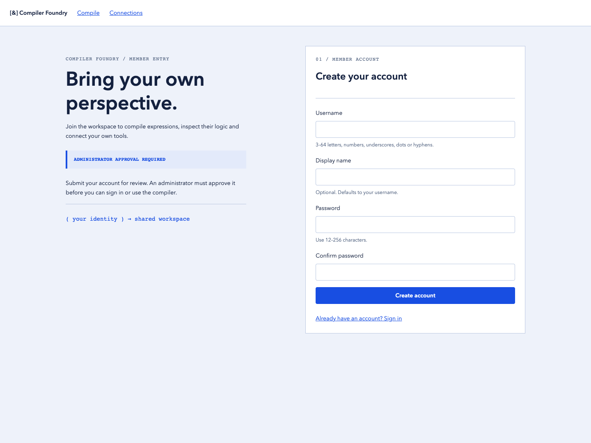
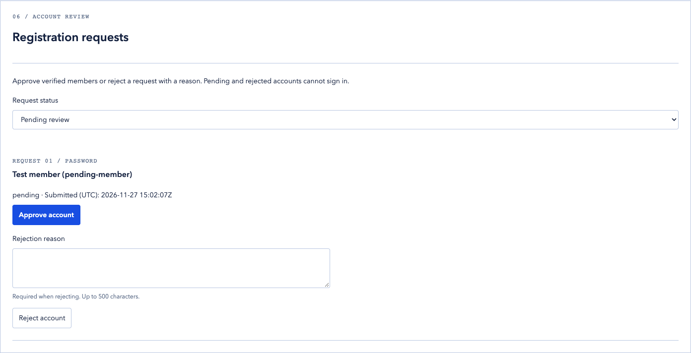

# Registration and administrator review verification

Registration extends the existing local account and Google/GitHub identity flows. The first account still uses `/first-login`; subsequent accounts receive member access under the administrator's closed, approval or open policy. Closed is the default.

## Reproduce

```sh
cargo build --manifest-path server/Cargo.toml --locked
FIRST_LOGIN_BINARY=server/target/debug/es-keyword-query-server python server/tests/registration_browser.py
```

The script starts disposable loopback servers with temporary databases and empty provider configuration. Use an absolute binary path if the Cargo target directory differs. It requires Python Playwright and Google Chrome. It creates test accounts only inside those temporary databases, terminates its servers, and removes their databases afterward.

The real browser workflow covers first-admin entry, default closed registration, approval policy, password confirmation, pending registration with no session, pending login denial, administrator approval followed by member login, rejection with a reason, open registration with member access, and the validated OAuth authorization continuation. A boundary regression creates a64-character username with a256-character password, signs out, and signs in again without truncating either field. That regression failed against the previous32/200-character login inputs before the non-setup login limits were widened; first-admin constraints stay unchanged.

Focused management-response mocks exercise request and history pagination, status filtering, required rejection reasons, stale review409 refresh, final-login-method error display, provider signup intent, and allowlisted provider notices. These checks use the actual frontend and password session; their mocked responses are UI tests, not backend security evidence. Run this portion alone with `--mocked-ui-only`.

## Browser and visual evidence

The browser script checks 1440px and390px layouts in light and dark themes with reduced motion. Visible elements must use font weights400/600 and padding, margin and gap values divisible by4. Every layout must fit the viewport. Registration captures are taken before entering credentials; administrator policy captures contain no password, token or provider subject. No browser storage is used for registration credentials or status.

Execution ledger (2026-11-27): the pre-implementation browser regression failed on the absent Registration policy section. The complete browser suite passes against the rebuilt registration backend at `/tmp/registration-rust-target/debug/es-keyword-query-server`, including the real password lifecycle and the focused management-response checks. The existing `server/tests/first_login_browser.py` also passes against that binary, including its first-admin race and continuation regressions. JavaScript syntax checks, Python compile checks and `git diff --check` pass. Captures below came from that disposable real-server run, with empty password fields.



[Mobile dark registration](images/registration-dark-390.png) · [Administrator policy, desktop light](images/registration-policy-light-1440.png) · [Administrator policy, mobile dark](images/registration-policy-dark-390.png)



[Pending application review, mobile dark](images/registration-review-dark-390.png). These review captures show the disposable member's submitted application before the browser approves it; the rejection reason field is empty.

Google/GitHub redirects are tested locally with configured-provider response fixtures. No live Google/GitHub application or production callback was exercised by this browser script. Backend provider transport and authorization tests are recorded separately by the backend verification.

## Backend verification

All19 host tests and32 shared access-kit tests passed, with fmt, warnings-denied Clippy, build and schema3 snapshot checks. Host migrations are additive; previous SQL bytes remain unchanged. Signup64-character usernames/256-character passwords remain usable on subsequent login;100-character display names remain editable. Administrator review and policy mutations require explicit canonical Origin and revalidate the current administrator session inside the transaction. Pending/rejected accounts cannot authenticate through cookies, API/MCP, OAuth codes or refresh. Provider-only accounts retain a final login method. Liveprovider callbacks are covered with controlled transports rather than deployment credentials.
