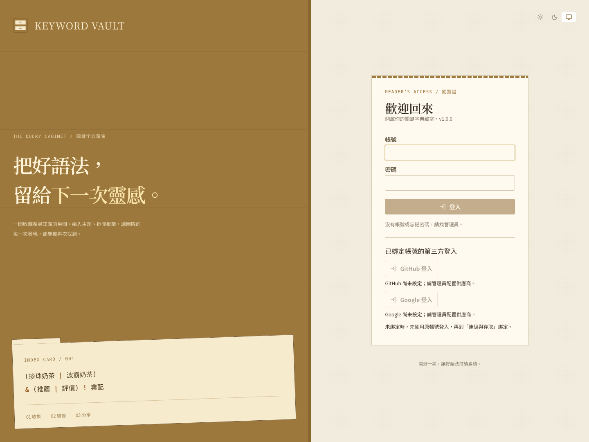

# Access integration verification

The host uses the identical frozen access-kit source SHA `d8574937a035c08671c17b586512eb9bf327a86621f5bcd2e8b7dc8a97e12f12`, authoring commit `1c28839becdcd00d28a718dfb40c174632011651`, schema SHA `234cd59820de024f7c472a9d8d5f3cb7f270ebe6a048c2b482910f22bf918d76`. `python crates/access-kit/scripts/snapshot.py --check` verifies the vendored bytes; host migration0002 is the identical core schema.

## Automated evidence

- Rust host tests and `cargo clippy --all-targets --locked -- -D warnings` pass against this snapshot. ES optional host:6 unit +3 access +1 stdin-bootstrap tests. Vault:12 unit +11 original domain integration +3 access tests. The host access tests run the actual rmcp3.12 client with protocol2026-07-28, API happy paths, revoked/disabled authority, audiences/scopes, and exact durable count-once assertions.
- Vault additionally proves current owner/public/group rules, immediate membership removal, private denial for unrelated administrators and forged-header denial. Its frontend20 tests pass, including once-only secret/focus return, provider-disabled state, request shape and immutable native consent forms; production build passes.
- Browser capture performs real password login, GitHub/Google linking through the loopback test provider, personal key create→API+official SDK→usage, admin client registration, PKCE/native consent approval→SDK, separate denial, grant/key revocation→denial. It asserts exactly3 recorded domain attempts and no bearer/canary payload in logs/events. Screenshots hide the raw key before capture.
- Actual browser computed-style checks cover1440/390px, light/dark, weights400/600 and padding/margin/gap multiples4. No page overflow or page errors. ES also checks long unbroken terms, keyboard clause selection and immediate final state under reduced motion. Real missing-provider instances prove disabled GitHub/Google login buttons. Source scans and PNG decode checks are part of the final review packet.

## Reproduce only in an isolated loopback demo

Build the host and SDK probe with `cargo build --manifest-path src/api/Cargo.toml --locked --features access-kit/test-support --example access_probe` and build the host binary with the same feature. Run the shared mock with:

```sh
cargo run --manifest-path crates/access-kit/Cargo.toml --features test-support --example mock_provider -- 127.0.0.1:19090
```

Set `ACCESS_TEST_MOCK_PROVIDER_URL=http://127.0.0.1:19090`, a dedicated data directory, and exact `ACCESS_PUBLIC_URL` on the demo host. This mock override is compiled out without test-support. Create a local demo account through the native setup, put its password in a private file, and run:

```sh
ACCESS_CAPTURE_PASSWORD_FILE=/private/demo/password ACCESS_CAPTURE_URL=http://127.0.0.1:18686 python docs/capture-access.py
```

The capture script requires Python Playwright with Chrome, refuses nonloopback URLs, writes three actual workflow PNGs, and mutates only the dedicated demo by binding providers/registering a client/creating then revoking credentials. Never run against production. The SDK probe accepts its bearer only through child-process environment and emits no secret.

## Deployment review

Live GitHub/Google application registration and production HTTPS callback delivery require deployment credentials and remain a manual deployment check. Recheck proxy canonical origin, cookie flags, provider redirect registration, retention/backup policy and browser screen-reader behavior in the intended deployment. Local mock results do not substitute for those checks.

Root reviewer independently passed Docker image builds and runtime smoke: native setup/login (ES stdin bootstrap), disabled-provider metadata, bearer API plus official Python MCP2.3 client negotiating Rust2026, exactly2 attempts/2 successes, revoke401 and persisted sessions/counts after restart. Evidence: `/tmp/tools-access-docker-smoke.log` and `/tmp/{es,vault}-access-docker-build.log`. Rebuild after any subsequent runtime changes. Reproduction uses `docker build -t keyword-vault:access .`. Run with `-p 8686:8686 -e ACCESS_PUBLIC_URL=http://127.0.0.1:8686 -v <volume>:/app/data`, then use existing native first-account setup.


